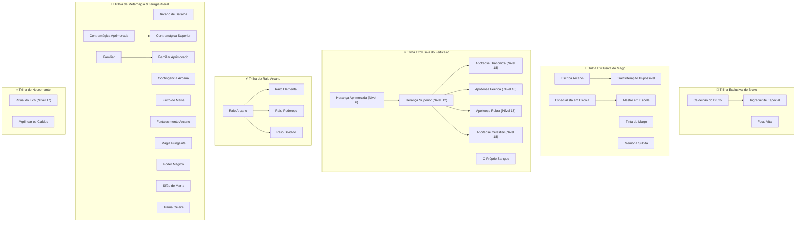

# 🔮 Arcanista

> [!t20-stats]
> - 🏷️ <span class="t20-roxo">Tipo:</span> Classe de Personagem
> - ❤️ <span class="t20-vermelho">Pontos de Vida:</span> 8 (+2 PV por nível além do 1º)
> - 💧 <span class="t20-ciano">Pontos de Mana:</span> 6 (+6 PM por nível além do 1º)
> - 🛡️ <span class="t20-azul">Proficiências:</span> Armas Simples, Armaduras Leves
> - 🎯 <span class="t20-verde">Perícias Básicas:</span> Misticismo, Vontade
> - 📚 <span class="t20-amarelo">Perícias Adicionais:</span> Mais 2 a sua escolha entre: Conhecimento, Diplomacia, Enganação, Guerra, Iniciativa, Intimidação, Intuição, Investigação, Nobreza, Ofício (Qualquer), Percepção

Mestre supremo das energias arcanas brutas, manipulador da própria tessitura da realidade. O arcanista canaliza o poder primordial do universo através de três vias distintas: a disciplina metódica e acadêmica dos tomos (**Mago**), a sintonia empírica com objetos catalisadores e espíritos familiares (**Bruxo**), ou a pura herança cósmica que pulsa em suas veias (**Feiticeiro**).

---

## ⚡ Progressão de Habilidades

| Nível | Habilidade | Resumo Operacional |
| :
---: | :
--- | :
--- |
| **1º** | [[Magias (Arcanista)|Magias]] | Lança magias arcanas de 1º círculo. A cada 4 níveis, desbloqueia um novo círculo (2º no 5º, 3º no 9º, 4º no 13º e 5º no 17º). |
| **1º** | [[Caminho do Arcanista]] | Escolhe seu caminho primordial: **Bruxo** (foco canalizador), **Mago** (grimório e memorização diária) ou **Feiticeiro** (lançamento espontâneo e linhagem sobrenatural). |
| **20º** | [[Alta Arcana]] | Custo em PM de todas as suas magias arcanas é reduzido à metade (cumulativo com outros redutores). |

---

## 📜 Regras Fundamentais do Arcanista

> [!regra] Magias Arcanas e Armaduras
> Lançar magias arcanas exige extrema precisão de gestos somáticos e foco mental desimpedido. 
> - **Penalidade de Armadura:** Se estiver usando qualquer armadura (leve ou pesada) ou escudo, para lançar uma magia arcana você precisa passar em um teste de **Misticismo (CD 15 + custo total em PM da magia)**. A penalidade de armadura de todo o seu equipamento é aplicada diretamente a esse teste!
> - **Falha no Teste:** Se falhar, a ação e os PM são gastos sem qualquer efeito (a magia é dissipada antes de se manifestar).
> - **Como contornar:** O poder de classe *Arcano de Guerra* permite lançar magias vestindo armaduras leves sem teste. Além disso, escudos e armaduras forjados com matérias-primas especiais (como *Mitral* ou *Gelo Eterno*) diminuem a penalidade de armadura acumulada.

> [!regra] Cálculo de CD e Limite de PM
> - **Classe de Dificuldade (CD):** `10 + metade do nível do personagem + modificador do atributo-chave` (Inteligência para Bruxo e Mago; Carisma para Feiticeiro).
> - **Limite de Gastos em PM:** Em uma mesma rodada ou ação, o arcanista nunca pode gastar uma quantidade de PM maior do que o seu nível de arcanista.

---

## 🔮 Os Três Caminhos do Arcanista

### 1. [[Caminho do Arcanista — Bruxo|O Bruxo]] (Conjuração por Foco)
O bruxo extrai e foca as correntes mágicas mundanas por meio de um objeto catalisador especial, estabelecendo uma ligação ritual com a matéria.
* **Atributo-Chave:** **Inteligência**. Você soma sua Inteligência ao total de PM e determina a CD das suas magias.
* **Magias Iniciais e Aprendizado:** Inicia com 3 magias arcanas de 1º círculo. A cada nível a partir do 2º, aprende automaticamente 1 nova magia arcana de qualquer círculo a que tenha acesso.
* **O Foco Arcano:** O bruxo precisa empunhar ou vestir seu foco (uma varinha, cajado, adaga, crânio, anel, chapéu ou orbe mundano).
  * *Perda ou Impossibilidade de Uso:* Se estiver sem o foco, para lançar qualquer magia arcana você deve ser bem-sucedido em um teste de **Misticismo (CD 15 + custo em PM da magia)**. Se falhar, os PM são gastos e a magia é perdida.
  * *Reposição do Foco:* Um foco destruído ou perdido pode ser substituído mediante um ritual que exige 1 semana de trabalho ininterrupto e matérias-primas no valor de T$ 100.

---

### 2. [[Caminho do Arcanista — Mago|O Mago]] (Grimório e Memorização Diária)
O mago compreende a magia como uma ciência exata e complexa. Ele domina o arcano decifrando fórmulas, diagramas planares e runas em seu tomo sagrado.
* **Atributo-Chave:** **Inteligência**. Você soma sua Inteligência ao total de PM e determina a CD das suas magias.
* **Magias Iniciais e Progressão:** Inicia com **4 magias arcanas de 1º círculo**. A cada novo nível, aprende 1 nova magia; nos níveis em que desbloqueia um novo círculo (5º, 9º, 13º e 17º níveis), aprende **2 novas magias**.
* **O Grimório e a Preparação Diária:**
  * O mago registra todas as suas magias em seu grimório.
  * A cada dia, após um descanso pleno de pelo menos 8 horas, você deve gastar **1 hora estudando seu grimório para preparar as magias** que poderá usar no dia.
  * **Limite de Preparação:** Você pode preparar um número de magias igual a **metade do total de magias que conhece + seu modificador de Inteligência** (mínimo de 1 magia).
  * Durante o dia, você **só pode lançar as magias que preparou** (embora possa lançar qualquer uma delas quantas vezes seus PM permitirem).
* **Copiando Novas Magias:** Um mago pode adicionar novas magias ao seu grimório copiando-as de pergaminhos ou dos tomos de outros conjuradores. O processo exige **T$ 50 e 1 dia de estudo e tintas alquímicas por círculo da magia**. Se perder o grimório, ele só pode lançar as magias que já estavam preparadas até descansar, necessitando recompor suas anotações em um tomo em branco.

---

### 3. [[Caminho do Arcanista — Feiticeiro|O Feiticeiro]] (Magia Espontânea e Linhagens)
Para o feiticeiro, a magia não é estudada nem negociada: ela é uma força viva herdada em seu sangue, um dom ancestral ou uma bênção cósmica que irrompe pelo poder da vontade.
* **Atributo-Chave:** **Carisma**. Você soma seu Carisma ao total de PM e determina a CD das suas magias.
* **Lançamento Espontâneo:** O feiticeiro **não precisa de foco e não memoriza magias**. Ele pode lançar livremente qualquer magia conhecida a qualquer momento, desde que tenha os PM necessários.
* **Magias Iniciais e Aprendizado:** Inicia com 3 magias arcanas de 1º círculo. Aprende **1 nova magia a cada nível ímpar** (3º, 5º, 7º, 9º, 11º, 13º, 15º, 17º e 19º níveis).
* **Linhagem Sobrenatural:** No 1º nível, você deve escolher uma das seguintes linhagens mágicas:

#### 🐉 [[Linhagem Dracônica]]
Descendente direto ou abençoado pela essência de dragões ancestrais. Escolha um tipo de energia: *ácido, eletricidade, fogo* ou *frio*.
* **Básica (1º Nível):** Você soma seu modificador de Carisma em seus PV iniciais e recebe Redução de Dano 5 (RD 5) contra o tipo de energia escolhido.
* **Aprimorada (6º Nível):** Suas magias do tipo escolhido custam –1 PM e causam +1 ponto de dano por dado rolado.
* **Superior (12º Nível):** Você passa a somar o **dobro do seu Carisma** em seus PV iniciais e torna-se completamente **imune** ao elemento escolhido. Além disso, sempre que reduz um ou mais inimigos a 0 PV com uma magia do elemento, recebe uma quantidade de PM temporários igual ao círculo da magia.

#### 🧚 [[Linhagem Feérica]]
Marcado pela graça sedutora e ilusória do reino de Wynlla e das fadas da Floresta Encantada.
* **Básica (1º Nível):** Torna-se treinado em Enganação e aprende uma magia de 1º círculo de *Encantamento* ou *Ilusão* (arcana ou divina), a sua escolha.
* **Aprimorada (6º Nível):** A CD para resistir às suas magias de Encantamento e Ilusão aumenta em +2 e essas magias custam –1 PM.
* **Superior (12º Nível):** Você recebe +2 em Carisma de forma permanente. Se uma criatura passar no teste de resistência contra uma magia de encantamento ou ilusão sua, você fica alquebrado até o fim da cena.

#### 🩸 [[Linhagem Rubra]]
Uma corrupção viva do sangue aberrante da tempestade alienígena da Tormenta e da matéria vermelha da Anti-Criação.
* **Básica (1º Nível):** Você recebe 1 poder da Tormenta à sua escolha. Além disso, pode escolher perder outro atributo à sua escolha em vez de Carisma pelas perdas causadas por poderes da Tormenta.
* **Aprimorada (6º Nível):** Escolha uma magia conhecida para cada poder da Tormenta que você possui; essas magias custam –1 PM. Sempre que adquire um novo poder da Tormenta, escolhe mais uma magia para receber este desconto. Conta como um poder da Tormenta.
* **Superior (12º Nível):** Você recebe +4 PM para cada poder da Tormenta que possui. Conta como um poder da Tormenta.

#### ☀️ [[Linhagem Abençoada]]
O toque celestial ou infernal de um deus maior corre em sua linhagem mortal (*Deuses de Arton*, p. 33).
* **Básica (1º Nível):** Você aprende uma magia divina de 1º círculo e pode aprender magias divinas de 1º círculo adicionais como se fossem magias de feiticeiro.
* **Aprimorada (6º Nível):** Suas magias divinas de círculo igual ou menor que sua Sabedoria custam –1 PM e você pode aprender magias divinas de 2º e 3º círculos como se fossem de feiticeiro.
* **Superior (12º Nível):** Você recebe +1 em Sabedoria permanente e aprende uma magia divina de cada círculo a que tenha acesso (limitado por sua Sabedoria). A cada dia, após descansar, pode trocar essas magias por outras dos mesmos círculos. Pode aprender magias divinas de 4º e 5º círculos como magias de feiticeiro.

---

## 🔮 Habilidade de Ápice

### [[Alta Arcana]] (20º Nível)
No 20º nível, seu domínio das artes arcanas transcende os limites mortais. O custo em PM de todas as suas magias arcanas é reduzido à metade (após aplicar aprimoramentos e quaisquer outros efeitos de redução).

---

## ⚔️ Árvores de Poderes de Arcanista

A partir do 2º nível, e a cada nível seguinte, você pode escolher um dos poderes da classe. Abaixo, os poderes estão organizados pelos seus **caminhos arcanos exclusivos e trilhas de especialização**:



---

### 🔮 1. Trilha Exclusiva do Bruxo (Foco Arcano & Poções)
Poderes exclusivos para arcanistas que escolheram o caminho do **Bruxo**:

```dataview
TABLE 
  resumo AS "Efeito Resumido",
  join(default(requer_poder, []), ", ") AS "Pré-requisitos",
  default(requer_nivel, "—") AS "Nível Mín.",
  join(default(magias_relacionadas, []), ", ") AS "Magias Vinculadas"
  FROM "Poderes/Classe/Arcanista" OR "Poderes/Classe/Comuns"
WHERE tipo = "poder" AND (!classes OR contains(classes, this.file.link)) AND caminho_exclusivo = "Bruxo"
SORT default(ordem, 999) ASC, default(requer_nivel, 1) ASC, file.name ASC
```

---

### 📜 2. Trilha Exclusiva do Mago (Grimório & Escolas de Magia)
Poderes de estudo aprofundado, transcrição e especialização para **Magos**:

```dataview
TABLE 
  resumo AS "Efeito Resumido",
  join(default(requer_poder, []), ", ") AS "Pré-requisitos",
  default(requer_nivel, "—") AS "Nível Mín.",
  join(default(magias_relacionadas, []), ", ") AS "Magias Vinculadas"
  FROM "Poderes/Classe/Arcanista" OR "Poderes/Classe/Comuns"
WHERE tipo = "poder" AND (!classes OR contains(classes, this.file.link)) AND (caminho_exclusivo = "Mago" OR caminho_exclusivo = "Mago / Bruxo")
SORT default(ordem, 999) ASC, default(requer_nivel, 1) ASC, file.name ASC
```

---

### 🔥 3. Trilha Exclusiva do Feiticeiro (Linhagens & Apoteoses)
Evoluções drásticas da herança sobrenatural inata do sangue do **Feiticeiro**:

```dataview
TABLE 
  resumo AS "Efeito Resumido",
  join(default(requer_poder, []), ", ") AS "Pré-requisitos",
  default(requer_nivel, "—") AS "Nível Mín.",
  join(default(magias_relacionadas, []), ", ") AS "Magias Vinculadas"
  FROM "Poderes/Classe/Arcanista" OR "Poderes/Classe/Comuns"
WHERE tipo = "poder" AND (!classes OR contains(classes, this.file.link)) AND caminho_exclusivo = "Feiticeiro"
SORT default(ordem, 999) ASC, default(requer_nivel, 1) ASC, file.name ASC
```

---

### ⚡ 4. Trilha do Raio Arcano (Evocação & Combate Direto)
Feixes devastadores de energia mágica disparados sem gastar espaços de magia tradicionais:

```dataview
TABLE 
  resumo AS "Efeito Resumido",
  join(default(requer_poder, []), ", ") AS "Pré-requisitos",
  default(requer_nivel, "—") AS "Nível Mín."
  FROM "Poderes/Classe/Arcanista" OR "Poderes/Classe/Comuns"
WHERE tipo = "poder" AND (!classes OR contains(classes, this.file.link)) AND trilha_poder = "Raio Arcano"
SORT default(ordem, 999) ASC, default(requer_nivel, 1) ASC, file.name ASC
```

---

### 💀 5. Trilha do Necromante & Não-Vida
Segredos profundos da transição da carne e da imortalidade sombria:

```dataview
TABLE 
  resumo AS "Efeito Resumido",
  join(default(requer_poder, []), ", ") AS "Pré-requisitos",
  default(requer_nivel, "—") AS "Nível Mín.",
  join(default(magias_relacionadas, []), ", ") AS "Magias Vinculadas"
  FROM "Poderes/Classe/Arcanista" OR "Poderes/Classe/Comuns"
WHERE tipo = "poder" AND (!classes OR contains(classes, this.file.link)) AND caminho_exclusivo = "Necromante"
SORT default(ordem, 999) ASC, default(requer_nivel, 1) ASC, file.name ASC
```

---

### 🌌 6. Trilha de Metamagia & Teurgia Geral (Acessível a Todos os Arcanistas)
Manipulação das teias arcanas, contramágicas, familiares e aprimoramento de conjuração geral:

```dataview
TABLE 
  resumo AS "Efeito Resumido",
  join(default(requer_poder, []), ", ") AS "Pré-requisitos",
  default(requer_nivel, "—") AS "Nível Mín.",
  join(default(magias_relacionadas, []), ", ") AS "Magias Vinculadas"
  FROM "Poderes/Classe/Arcanista" OR "Poderes/Classe/Comuns"
WHERE tipo = "poder" AND (!classes OR contains(classes, this.file.link)) AND (trilha_poder = "Metamagia & Geral" OR trilha_poder = "Geral")
SORT default(ordem, 999) ASC, default(requer_nivel, 1) ASC, file.name ASC
```