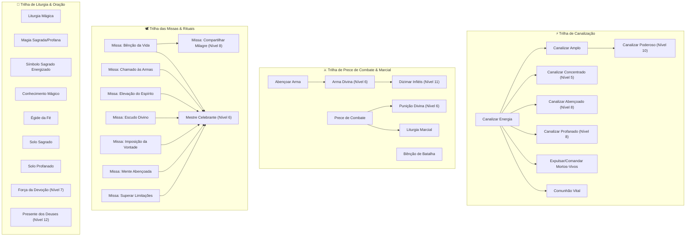

# ☀️ Clérigo

> [!t20-stats]
> - 🏷️ <span class="t20-roxo">Tipo:</span> Classe de Personagem
> - ❤️ <span class="t20-vermelho">Pontos de Vida:</span> 16 (+4 PV por nível além do 1º)
> - 💧 <span class="t20-ciano">Pontos de Mana:</span> 5 (+5 PM por nível além do 1º)
> - 🛡️ <span class="t20-azul">Proficiências:</span> Armas Simples, Armaduras Leves, Armaduras Pesadas, Escudos
> - 🎯 <span class="t20-verde">Perícias Básicas:</span> Religião, Vontade
> - 📚 <span class="t20-amarelo">Perícias Adicionais:</span> Mais 2 a sua escolha entre: Conhecimento, Cura, Diplomacia, Fortitude, Iniciativa, Intuição, Luta, Misticismo, Nobreza, Ofício (Qualquer), Percepção

Sacerdote devoto ungido diretamente por uma das divindades do Panteão, canalizando bênçãos divinas, magias milagrosas e punição celestial aos infiéis.

---

## ⚡ Progressão de Habilidades

| Nível | Habilidade | Resumo Operacional |
| :
---: | :
--- | :
--- |
| **1º** | [[Devoto Fiel (Clérigo)|Devoto Fiel]] | Você se torna devoto de um deus maior. Recebe seus poderes concedidos e segue suas Obrigações e Restrições. |
| **1º** | [[Magias (Clérigo)|Magias]] | Lança magias divinas de 1º círculo. A cada 4 níveis, desbloqueia um novo círculo (2º no 5º, 3º no 9º, 4º no 13º e 5º no 17º). |
| **20º** | [[Mão da Divindade]] | Recupera 1d10 PM no início do seu turno e o custo de todas as suas magias divinas diminui em –1 PM. |

---

## 📖 Descrição Completa das Habilidades de Clérigo

### [[Devoto Fiel (Clérigo)|Devoto Fiel]] (1º Nível)
Você se torna devoto de um deus maior. Veja as regras de devotos na página 96 do livro básico. Ao contrário de devotos normais, você recebe dois poderes concedidos de sua divindade padroeira (em vez de apenas um), mas continua precisando seguir suas Obrigações e Restrições sagradas.

### [[Magias (Clérigo)|Magias]] (1º Nível)
Você pode lançar magias divinas de 1º círculo. A cada quatro níveis, pode lançar magias de um círculo maior (2º círculo no 5º nível, 3º círculo no 9º nível, 4º no 13º nível e 5º no 17º nível).
- **Atributo-Chave:** Seu atributo-chave para lançar magias é **Sabedoria**. Você soma sua Sabedoria no seu total de pontos de mana e para determinar a CD para resistir às suas magias.
- **Preparação e Magias Iniciais:** Você começa conhecendo três magias de 1º círculo. A cada nível a partir do 2º, aprende uma nova magia divina de qualquer círculo a que tenha acesso.

### [[Mão da Divindade]] (20º Nível)
No 20º nível, você se torna o receptáculo supremo do poder divino em Arton. No início de cada um dos seus turnos, você **recupera 1d10 pontos de mana**. Além disso, o custo em pontos de mana de todas as suas magias divinas é reduzido em **–1** (cumulativo com outros redutores).

---

## ⚔️ Árvores de Poderes de Clérigo

A partir do 2º nível, e a cada nível seguinte, você pode escolher um dos poderes da classe. Abaixo, os poderes canônicos estão organizados pelas suas linhas de pré-requisitos e temas litúrgicos:



---

### ⚡ 1. Trilha de Canalização de Energia Divina
Ondas puras de energia positiva para cura de ferimentos em área ou energia negativa devastadora contra os vivos:

```dataview
TABLE
  resumo AS "Efeito Resumido",
  join(default(requer_poder, []), ", ") AS "Pré-requisitos",
  default(requer_nivel, "—") AS "Nível Mín.",
  join(default(magias_relacionadas, []), ", ") AS "Magias Vinculadas"
  FROM "Poderes/Classe/Clérigo" OR "Poderes/Classe/Comuns"
WHERE tipo = "poder" AND (!classes OR contains(classes, this.file.link)) AND trilha_poder = "Canalização"
SORT default(ordem, 99) ASC, default(requer_nivel, 1) ASC, file.name ASC
```

---

### ⚔️ 2. Trilha Litúrgica & Prece de Combate
Técnicas de guerra santa, lâminas sagradas e aceleração de preces para combate corporal:

```dataview
TABLE
  resumo AS "Efeito Resumido",
  join(default(requer_poder, []), ", ") AS "Pré-requisitos",
  default(requer_nivel, "—") AS "Nível Mín.",
  join(default(magias_relacionadas, []), ", ") AS "Magias Vinculadas"
  FROM "Poderes/Classe/Clérigo" OR "Poderes/Classe/Comuns"
WHERE tipo = "poder" AND (!classes OR contains(classes, this.file.link)) AND trilha_poder = "Prece de Combate"
SORT default(ordem, 99) ASC, default(requer_nivel, 1) ASC, file.name ASC
```

---

### 🕊️ 3. Trilha das Missas & Rituais Coletivos
Rituais de consagração e celebrações litúrgicas de 1 hora que concedem bênçãos persistentes a você e todos os seus aliados:

```dataview
TABLE
  resumo AS "Efeito Resumido",
  join(default(requer_poder, []), ", ") AS "Pré-requisitos",
  default(requer_nivel, "—") AS "Nível Mín.",
  join(default(magias_relacionadas, []), ", ") AS "Magias Vinculadas"
  FROM "Poderes/Classe/Clérigo" OR "Poderes/Classe/Comuns"
WHERE tipo = "poder" AND (!classes OR contains(classes, this.file.link)) AND trilha_poder = "Missas"
SORT default(ordem, 99) ASC, default(requer_nivel, 1) ASC, file.name ASC
```

---

### 📜 4. Trilha de Liturgia Mágica & Oração
Fortalecimento da conjuração, redução de custos em PM, terrenos consagrados e milagres diretos:

```dataview
TABLE
  resumo AS "Efeito Resumido",
  join(default(requer_poder, []), ", ") AS "Pré-requisitos",
  default(requer_nivel, "—") AS "Nível Mín.",
  join(default(magias_relacionadas, []), ", ") AS "Magias Vinculadas"
  FROM "Poderes/Classe/Clérigo" OR "Poderes/Classe/Comuns"
WHERE tipo = "poder" AND (!classes OR contains(classes, this.file.link)) AND trilha_poder = "Liturgia & Oração"
SORT default(ordem, 99) ASC, default(requer_nivel, 1) ASC, file.name ASC
```

---

### 🌟 5. Trilha Geral
```dataview
TABLE
  resumo AS "Efeito Resumido",
  join(default(requer_poder, []), ", ") AS "Pré-requisitos",
  default(requer_nivel, "—") AS "Nível Mín."
  FROM "Poderes/Classe/Clérigo" OR "Poderes/Classe/Comuns"
WHERE tipo = "poder" AND (!classes OR contains(classes, this.file.link)) AND (trilha_poder = "Geral" OR !trilha_poder)
SORT default(requer_nivel, 1) ASC, file.name ASC
```