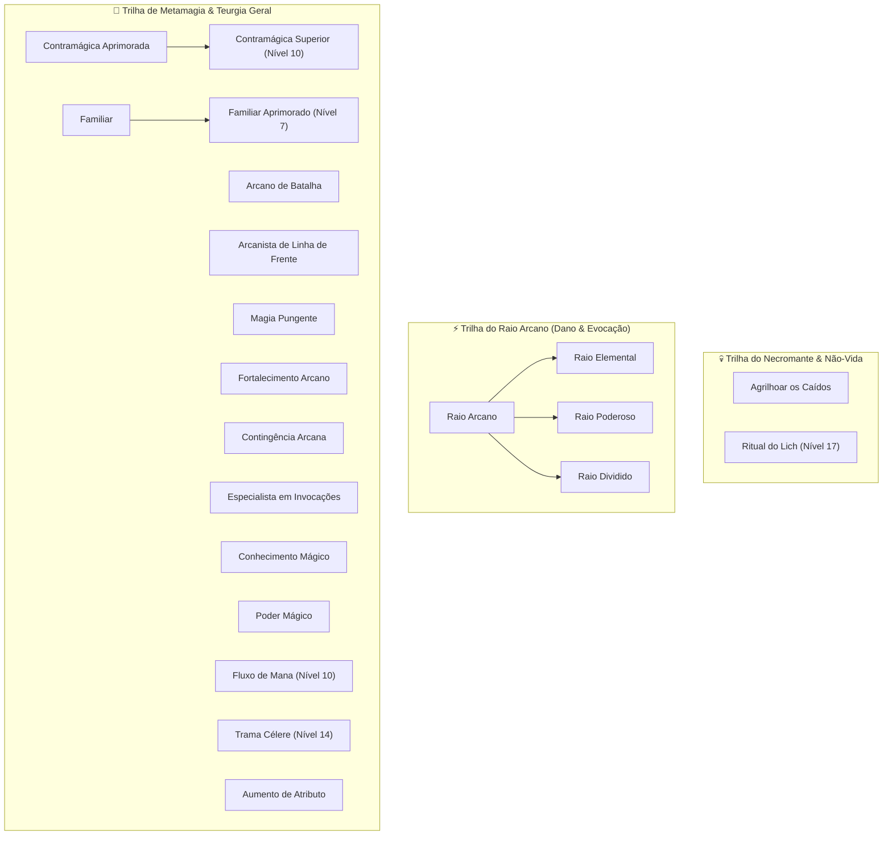

# 💀 Necromante

> [!t20-stats]
> - 🏷️ <span class="t20-roxo">Tipo:</span> Classe Variante de [[Arcanista]] (*Heróis de Arton*)
> - ❤️ <span class="t20-vermelho">Pontos de Vida:</span> 8 (+2 PV por nível além do 1º)
> - 💧 <span class="t20-ciano">Pontos de Mana:</span> 6 (+6 PM por nível além do 1º)
> - 🛡️ <span class="t20-azul">Proficiências:</span> Armas Simples, Armaduras Leves
> - 🎯 <span class="t20-verde">Perícias Básicas:</span> Misticismo, Vontade
> - 📚 <span class="t20-amarelo">Perícias Adicionais:</span> Mais 2 a sua escolha entre: Conhecimento, Cura, Diplomacia, Enganação, Fortitude, Iniciativa, Intimidação, Intuição, Investigação, Nobreza, Ofício (Qualquer), Percepção

O Necromante manipula os segredos proibidos da transição entre a carne viva e a morte eterna. Não se apega às sutilezas mundanas: sua magia flui a partir de um pacto visceral com a entropia e com os espíritos errantes de Arton.

---

## ⚡ Progressão de Habilidades

| Nível | Habilidade | Resumo Operacional |
| :
---: | :
--- | :
--- |
| **1º** | [[Caminho do Necromante]] | Lança magias gastando PV para abrir conexão com a morte. Aprende magias divinas de necromancia. Não aprende encantamento. |
| **1º** | [[Falar com Mortos]] | Usa Misticismo para persuasão com mortos-vivos. A partir do 3º nível, pode conversar com cadáveres (1 PM). |
| **1º** | [[Magias]] | Lança magias arcanas/necromânticas de 1º círculo. Desbloqueia círculos superiores a cada 4 níveis (2º no 5º, 3º no 9º, 4º no 13º, 5º no 17º). |
| **2º** | [[Animar Cadáver]] | Ergue um cadáver como parceiro iniciante (3 PM). Pode sacrificá-lo para reduzir dano sofrido à metade. Evolui no 7º e 11º níveis. |
| **3º** | [[Necrologia]] | Recebe +2 em Cura, Fortitude e na CD de suas magias de necromancia (+1 a cada 5 níveis). |
| **4º** | [[Distorção Necrótica]] | Altera a escola de uma magia conhecida de 1º círculo para Necromancia. |
| **5º** | [[Necropotência]] | Gasta o dobro de PV na conexão para recuperar 2 PM temporários ao eliminar inimigos vivos com necromancia. |
| **20º** | [[Domínio Sobre a Morte]] | Magias de necromancia custam metade do PM. Ergue cadáveres imediatamente como servos ao matá-los. |

---

## 📖 Descrição Completa das Habilidades de Necromante

### [[Caminho do Necromante]] (1º Nível)
Você lança magias por meio de uma conexão direta e profana com a morte. 
- Você pode aprender **magias de necromancia divinas como se fossem arcanas**.
- Você **não pode aprender magias da escola de Encantamento**.
- Pelo menos metade de todas as magias que você aprender devem pertencer obrigatoriamente à escola de **Necromancia**.
- **Conexão com a Morte:** Para lançar suas magias, você precisa primeiro ativar sua conexão com a morte. Para isso, deve **gastar uma quantidade de PV igual ao círculo máximo de magias que deseja usar** (limitado pelo círculo máximo a que tem acesso). Uma vez ativada, a conexão se mantém até o fim da cena.
- Seu atributo-chave para magias é **Inteligência**.

### [[Falar com Mortos]] (1º Nível)
Você pode se comunicar com mortos-vivos por meio de seus poderes arcanos. Você pode usar a perícia **Misticismo** com mortos-vivos para testes de persuasão e mudar atitude. 
- A partir do 3º nível, você pode gastar uma ação padrão e 1 PM para conversar com um cadáver em alcance curto (funciona como a magia *Voz Divina* com o aprimoramento de conceder um sopro efêmero de consciência ao corpo inerte).

### [[Magias]] (1º Nível)
Inicia com 3 magias conhecidas de 1º círculo e aprende 1 nova magia a cada nível. Desbloqueia o 2º círculo no 5º nível, 3º no 9º, 4º no 13º e 5º no 17º.

### [[Animar Cadáver]] (2º Nível)
No 2º nível, você pode gastar uma ação completa e 3 PM para animar o cadáver de uma criatura Pequena, Média ou Grande em alcance curto. 
- O cadáver se torna um **parceiro iniciante** de um tipo a sua escolha, adequado ao seu tamanho e anatomia, que não conta em seu limite de parceiros (mas você só pode ter um parceiro cadáver por vez).
- **Sacrifício:** Quando sofre dano, você pode sacrificar o parceiro cadáver como uma reação para reduzir esse dano à metade. Cadáveres sacrificados são destruídos e não podem ser reanimados.
- **Evolução:** A partir do 7º nível, você pode gastar 6 PM para erguer um parceiro **veterano**. A partir do 11º nível, pode gastar 9 PM para criar um parceiro **mestre**.

### [[Necrologia]] (3º Nível)
No 3º nível, você compreende a anatomia putrefata em profundidade. Você recebe **+2 em Cura, Fortitude e na CD para resistir às suas magias de necromancia**. A cada cinco níveis além do 3º (8º, 13º e 18º níveis), esse bônus aumenta em +1.

### [[Distorção Necrótica]] (4º Nível)
No 4º nível, escolha uma de suas magias conhecidas de 1º círculo que não seja de necromancia. A escola dessa magia muda permanentemente para **Necromancia**. Essa alteração infunde os efeitos visuais e a natureza da magia com energia cadavérica e fúnebre.

### [[Necropotência]] (5º Nível)
No 5º nível, quando estabelece sua conexão com a morte, você pode gastar o dobro de PV. Se fizer isso, sempre que reduzir um ou mais inimigos vivos a 0 PV ou menos com uma magia de necromancia, você **recebe 2 PM temporários**. Você pode acumular um máximo de PM temporários por cena igual ao seu nível de necromante.

### [[Domínio Sobre a Morte]] (20º Nível)
No 20° nível, você domina as fronteiras da vida e do descanso final:
- O custo em PM de todas as suas magias de necromancia é **reduzido à metade** (após aplicar aprimoramentos).
- Quando você mata uma criatura viva com uma magia de necromancia, pode gastar 2 PM para erguer seu cadáver instantaneamente sob seu controle (como a magia *Servo Morto-Vivo*, escolhendo qualquer tipo de parceiro sem pagar componentes materiais e sem contar no limite de parceiros pela duração da cena).

---

## 💀 Poder Exclusivo: Ritual do Lich

O Necromante possui acesso ao poder de ápice da imortalidade:
* [[Ritual do Lich]]: *(Pré-requisitos: Celebrar Ritual, Escrever Pergaminho, Preparar Poção, 17º nível).* Você aprisiona sua alma em um filactério e transcende a carne, renascendo como um autêntico Lich de Arton.

---

## ⚔️ Poderes de Arcanista Disponíveis para Necromante

Como classe variante de [[Arcanista]], o Necromante substitui o *Caminho do Arcanista* por [[Caminho do Necromante]]:
- **Poderes Acessíveis:** O Necromante pode escolher todos os poderes da **Trilha do Necromante**, da **Trilha do Raio Arcano**, da **Trilha de Metamagia & Teurgia Geral** e os **Poderes Gerais**.
- **Restrições de Caminho:** O Necromante **não pode** escolher poderes restritos exclusivamente a *Bruxo* (ex: *Caldeirão do Bruxo*, *Foco Vital*), *Mago* (ex: *Escriba Arcano*, *Tinta do Mago*) ou *Feiticeiro* (ex: *Herança Aprimorada*, *Apoteoses*), pois não possui foco, grimório diário ou linhagens elementais de sangue.



---

### 💀 1. Trilha do Necromante & Não-Vida
Segredos profundos da carne reanimada e da imortalidade definitiva:

```dataview
TABLE 
  resumo AS "Efeito Resumido",
  join(default(requer_poder, []), ", ") AS "Pré-requisitos",
  default(requer_nivel, "—") AS "Nível Mín.",
  join(default(magias_relacionadas, []), ", ") AS "Magias Vinculadas"
FROM "Poderes/Classe/Arcanista"
WHERE tipo = "poder" AND caminho_exclusivo = "Necromante"
SORT default(ordem, 999) ASC, default(requer_nivel, 1) ASC, file.name ASC
```

---

### ⚡ 2. Trilha do Raio Arcano
Descargas concentradas de energia mágica crua para combate à distância:

```dataview
TABLE 
  resumo AS "Efeito Resumido",
  join(default(requer_poder, []), ", ") AS "Pré-requisitos",
  default(requer_nivel, "—") AS "Nível Mín."
FROM "Poderes/Classe/Arcanista"
WHERE tipo = "poder" AND trilha_poder = "Raio Arcano"
SORT default(ordem, 999) ASC, default(requer_nivel, 1) ASC, file.name ASC
```

---

### 🌌 3. Trilha de Metamagia & Teurgia Geral
Aprimoramento de conjuração, manipulação de custo em PM e familiares servos:

```dataview
TABLE 
  resumo AS "Efeito Resumido",
  join(default(requer_poder, []), ", ") AS "Pré-requisitos",
  default(requer_nivel, "—") AS "Nível Mín.",
  join(default(magias_relacionadas, []), ", ") AS "Magias Vinculadas"
FROM "Poderes/Classe/Arcanista" OR "Poderes/Classe/Comuns"
WHERE tipo = "poder" AND (trilha_poder = "Metamagia & Geral" OR trilha_poder = "Geral") AND (!classes OR contains(classes, this.file.link) OR contains(classes, this.classe_base)) AND !contains(default(this.poderes_proibidos, []), file.link)
SORT default(ordem, 999) ASC, default(requer_nivel, 1) ASC, file.name ASC
```
