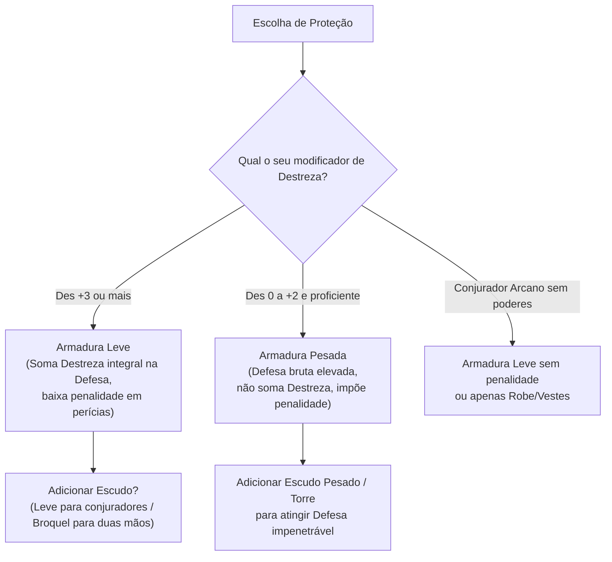

# 🛡️ Guia Comparativo: Armaduras Leves, Armaduras Pesadas e Escudos

> [!t20-lore] A Arte de Sobreviver em Arton
> Escolher a proteção certa em Tormenta20 não é apenas uma questão de acumular o maior número na ficha: é um equilíbrio tático entre **Defesa**, **mobilidade (Destreza)**, **penalidade em perícias**, **capacidade de carga (espaços)** e **recursos financeiros (T$)**.

---

## 🧭 Princípios Mecânicos Fundamentais

Antes de consultar as tabelas detalhadas, compreenda as três regras de ouro das armaduras no *Tormenta20: Jogo do Ano*:



1. **Armaduras Leves (2 espaços):** Permitem **somar todo o seu modificador de Destreza** na Defesa. Ideais para Ladinos, Bucaneiros, Caçadores, Bardos e Arcanistas. A penalidade de armadura afeta apenas perícias baseadas em Força e Destreza (*Acrobacia, Atletismo, Furtividade, Ladinagem*).
2. **Armaduras Pesadas (5 espaços):** **Não permitem somar a Destreza** na Defesa (exceto se modificadas com *Mitral* ou com poderes de combate como *Encouraçado*). Oferecem proteção bruta imediata para Guerreiros, Cavaleiros, Paladinos e Clérigos, mas impõem penalidades severas e exigem proficiência.
3. **Escudos (1 a 2 espaços):** Fornecem bônus cumulativo com armaduras. O *Broquel* deixa a mão livre (ideal para arcanistas ou atiradores); o *Escudo Leve* permite empunhar itens leves; o *Escudo Pesado* e o *Escudo Torre* oferecem cobertura máxima para combatentes de linha de frente.

---

## 📊 1. Ranking Geral por Defesa Bruta

Visão panorâmica de todas as armaduras e escudos do sistema, ordenados da maior proteção para a menor.

```dataview
TABLE bonus_defesa AS "Defesa", penalidade_armadura AS "Penalidade", preco_ts AS "Preço (T$)", espacos AS "Espaços"
FROM "Itens/Armaduras" OR "Itens/Escudos"
WHERE tipo = "item"
SORT bonus_defesa DESC, penalidade_armadura DESC, preco_ts ASC
```

---

## 🏃 2. Armaduras Leves — Mobilidade e Destreza

> [!t20-item] Análise Tática: Leves
> - **Penalidade Zero (Conjuradores e Furtivos):** *Armadura de Couro* (+2), *Armadura de Folhas* (+2), *Armadura Acolchoada* (+1), *Armadura Sensual* (+1) e a lendária *Veste de Teia de Aranha* (+4) e *Manto da Noite* (+5) não impõem qualquer penalidade de armadura (Pen 0).
> - **Padrão de Combate Ágil:** A *Couraça* (+5, Pen –4, T$ 500) é o teto das armaduras leves mundanas: para personagens com Destreza +3 ou +4, ela entrega Defesa 18 a 19 mantendo a mobilidade. Para orçamentos menores, o *Gibão de Peles* (+4, Pen –3, T$ 25) oferece excelente custo-benefício.

```dataview
TABLE bonus_defesa AS "Defesa", penalidade_armadura AS "Penalidade", preco_ts AS "Preço (T$)", espacos AS "Espaços"
FROM "Itens/Armaduras/Leves"
WHERE tipo = "item"
SORT bonus_defesa DESC, penalidade_armadura DESC, preco_ts ASC
```

---

## 🛡️ 3. Armaduras Pesadas — Fortaleza de Aço

> [!t20-item] Análise Tática: Pesadas
> - **O Padrão Ouro:** A *Armadura Completa* (+10, Pen –5, T$ 3.000) é a meta de todo combatente pesado em níveis iniciais e médios. Combinada com um *Escudo Pesado* (+2), garante Defesa 22 sem depender de Destreza.
> - **Custo-Benefício Inicial:** No 1º nível, a *Brunea* (+5, Pen –2, T$ 50) e a *Cota de Malha* (+6, Pen –2, T$ 150) oferecem proteção acessível antes de juntar tibares para peças maiores.
> - **Obras-Primas Mágicas:** Peças como *Armadura do Dragão Ancião* (+14), *Baluarte Anão* (+13, RD 10 parada), *Carapaça Demoníaca* (+13) e *Armadura da Luz* (+13) atingem o patamar lendário de proteção em Arton.

```dataview
TABLE bonus_defesa AS "Defesa", penalidade_armadura AS "Penalidade", preco_ts AS "Preço (T$)", espacos AS "Espaços"
FROM "Itens/Armaduras/Pesadas"
WHERE tipo = "item"
SORT bonus_defesa DESC, penalidade_armadura DESC, preco_ts ASC
```

---

## 🛡️ 4. Escudos — Defesa Adicional e Mãos Livres

> [!t20-item] Análise Tática: Escudos
> - **Broquel (+0 Defesa / +1 com poderes, Pen –1, T$ 25, 0.5 esp):** Preso ao antebraço, deixa a mão livre para lançar magias, recarregar armas de disparo ou segurar itens.
> - **Escudo Leve (+1 Defesa, Pen –1, T$ 5, 1 esp):** Permite segurar um objeto leve ou tocha na mesma mão.
> - **Escudo Pesado (+2 Defesa, Pen –2, T$ 15, 2 esp):** Ocupa a mão inteiramente; base sólida para qualquer linha de frente.
> - **Escudo Torre (+2 Defesa, Pen –4, T$ 45, 2 esp):** Fornece cobertura parcial e bônus defensivos ampliados para posturas de guarda.
> - **Escudo de Azgher (+5 Defesa Mágica, Pen –2, T$ 140.000):** Escudo sagrado capaz de disparar luz solar purificadora e revelar a verdade.

```dataview
TABLE bonus_defesa AS "Defesa", penalidade_armadura AS "Penalidade", preco_ts AS "Preço (T$)", espacos AS "Espaços"
FROM "Itens/Escudos"
WHERE tipo = "item"
SORT bonus_defesa DESC, penalidade_armadura DESC, preco_ts ASC
```

---

## 🥷 5. Proteções Silenciosas (Penalidade 0 a –1)

Filtro dedicado para personagens furtivos, acrobatas e conjuradores que não podem sofrer penalidades em seus testes de perícias físicas.

```dataview
TABLE bonus_defesa AS "Defesa", penalidade_armadura AS "Penalidade", preco_ts AS "Preço (T$)", espacos AS "Espaços"
FROM "Itens/Armaduras" OR "Itens/Escudos"
WHERE tipo = "item" AND penalidade_armadura >= -1
SORT bonus_defesa DESC, penalidade_armadura DESC, preco_ts ASC
```

---

## 💰 6. Melhores Opções para Início de Carreira (Até T$ 100)

Tabela otimizada para compras no 1º nível, filtrando peças econômicas que entregam a máxima Defesa para o orçamento inicial dos aventureiros.

```dataview
TABLE subtipo AS "Categoria", bonus_defesa AS "Defesa", penalidade_armadura AS "Penalidade", preco_ts AS "Preço (T$)"
FROM "Itens/Armaduras" OR "Itens/Escudos"
WHERE tipo = "item" AND preco_ts <= 100
SORT bonus_defesa DESC, preco_ts ASC
```
