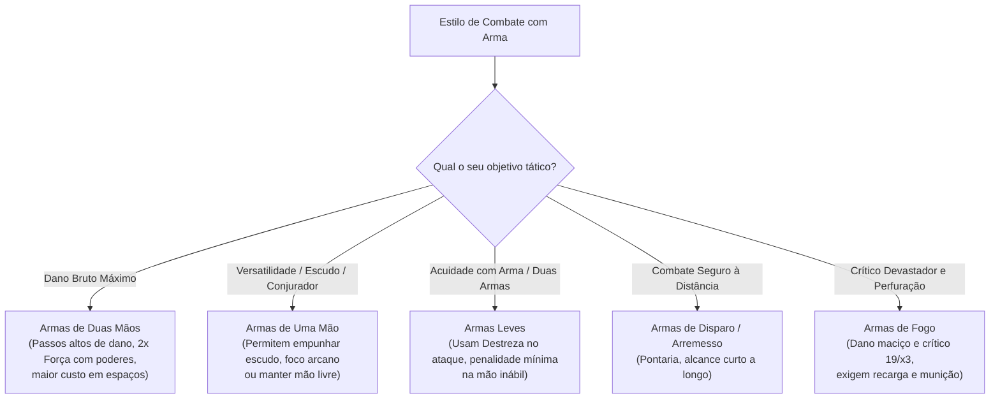

# ⚔️ Guia Comparativo de Armas de Arton

> [!t20-lore] A Escolha do Aço
> Em Tormenta20, uma arma não é apenas um dado de dano: é a extensão da postura de combate do aventureiro. A escolha depende da **proficiência**, do estilo de luta (**Uma Mão**, **Duas Mãos**, **Duas Armas**, **Disparo** ou **Arma de Fogo**) e dos atributos dominantes do personagem (**Força**, **Destreza** ou **Inteligência**).

---

## 🧭 Princípios Mecânicos e Trade-Offs de Empunhadura



1. **Armas Leves (1 esp):** Podem ser usadas com o poder *Acuidade com Arma* para somar Destreza em vez de Força nos testes de ataque. São essenciais para o *Estilo de Duas Armas* na mão inábil.
2. **Armas de Uma Mão (1 esp):** Oferecem o equilíbrio perfeito para personagens que usam escudo (*Estilo de Arma e Escudo*), conjuradores com foco esotérico ou duelistas (*Estilo de Uma Arma*).
3. **Armas de Duas Mãos (2 esp):** Exigem as duas mãos livres e se beneficiam do *Estilo de Duas Mãos* e *Ataque Poderoso*, entregando as maiores médias de dano do jogo.
4. **Armas à Distância:** Divididas entre arremesso (usam Força no dano) e disparo (arcos somam Força com compostos; bestas não somam atributo no dano, mas possuem passos altos).
5. **Armas de Fogo:** Causam passos de dano massivos (2d6 a 3d6) com multiplicadores letais (19/x3). Exigem ação de movimento ou padrão para recarregar (reduzível com *Saque Rápido* e melhorias).

---

## 🗡️ 1. Armas Simples

> [!t20-stats] Perfil: Simples
> Armas acessíveis a praticamente todas as classes do jogo (incluindo arcanistas, clérigos e especialistas). Baratas e fáceis de encontrar em qualquer feira de Arton.

### 🔹 Corpo a Corpo: Leves e Uma Mão
Ideais para conjuradores arcanos, curandeiros e combatentes leves de apoio.

```dataview
TABLE dano AS "Dano", critico AS "Crítico", tipo_dano AS "Tipo", preco_ts AS "Preço (T$)", espacos AS "Esp."
FROM "Itens/Armas"
WHERE subtipo = "arma-simples" AND (empunhadura = "leve" OR empunhadura = "uma-mao")
SORT dano DESC, preco_ts ASC
```

### 🔹 Corpo a Corpo: Duas Mãos
Armas simples com alto impacto de impacto e alcance estendido.

```dataview
TABLE dano AS "Dano", critico AS "Crítico", tipo_dano AS "Tipo", preco_ts AS "Preço (T$)", espacos AS "Esp."
FROM "Itens/Armas"
WHERE subtipo = "arma-simples" AND empunhadura = "duas-maos"
SORT dano DESC, preco_ts ASC
```

### 🔹 Ataque à Distância
Projéteis econômicos para combate inicial sem exigir treinamento especializado.

```dataview
TABLE dano AS "Dano", critico AS "Crítico", alcance AS "Alcance", preco_ts AS "Preço (T$)", espacos AS "Esp."
FROM "Itens/Armas"
WHERE subtipo = "arma-simples" AND empunhadura = "distancia"
SORT alcance DESC, dano DESC
```

---

## ⚔️ 2. Armas Marciais

> [!t20-stats] Perfil: Marciais
> O arsenal padrão de classes combatentes profissionais (Guerreiros, Paladinos, Bárbaros, Cavaleiros, Caçadores e Bucaneiros). Projetadas para letalidade máxima e versatilidade tática.

### 🔹 Corpo a Corpo: Leves
Precisão cirúrgica para combatentes ágeis, ladinos e duelistas de duas armas.

```dataview
TABLE dano AS "Dano", critico AS "Crítico", tipo_dano AS "Tipo", preco_ts AS "Preço (T$)", espacos AS "Esp."
FROM "Itens/Armas"
WHERE subtipo = "arma-marcial" AND empunhadura = "leve"
SORT critico DESC, dano DESC
```

### 🔹 Corpo a Corpo: Uma Mão
A espinha dorsal dos guerreiros de Arton: espadas longas, machados de batalha, tridentes e martelos de guerra.

```dataview
TABLE dano AS "Dano", critico AS "Crítico", tipo_dano AS "Tipo", preco_ts AS "Preço (T$)", espacos AS "Esp."
FROM "Itens/Armas"
WHERE subtipo = "arma-marcial" AND empunhadura = "uma-mao"
SORT dano DESC, critico DESC, preco_ts ASC
```

### 🔹 Corpo a Corpo: Duas Mãos
Montantes, machados de guerra, alabardas e malhos projetados para abrir fendas em armaduras pesadas.

```dataview
TABLE dano AS "Dano", critico AS "Crítico", tipo_dano AS "Tipo", preco_ts AS "Preço (T$)", espacos AS "Esp."
FROM "Itens/Armas"
WHERE subtipo = "arma-marcial" AND empunhadura = "duas-maos"
SORT dano DESC, critico DESC, preco_ts ASC
```

### 🔹 Ataque à Distância
Arcos longos de grande alcance e bestas pesadas de alta perfuração.

```dataview
TABLE dano AS "Dano", critico AS "Crítico", alcance AS "Alcance", preco_ts AS "Preço (T$)", espacos AS "Esp."
FROM "Itens/Armas"
WHERE subtipo = "arma-marcial" AND empunhadura = "distancia"
SORT alcance DESC, dano DESC
```

---

## 🐉 3. Armas Exóticas

> [!t20-stats] Perfil: Exóticas
> Armas raras de povos específicos, tradições orientais de Tamu-ra ou engenharia singular. Exigem o poder geral *Proficiência (Armas Exóticas)*, compensando com margens de ameaça expandidas, manobras especiais (derrubar, desarmar) ou alcance tático.

### 🔹 Corpo a Corpo: Leves e Uma Mão
Katanas lendárias, chicotes, correntes de espinhos e machados anões.

```dataview
TABLE dano AS "Dano", critico AS "Crítico", tipo_dano AS "Tipo", preco_ts AS "Preço (T$)", espacos AS "Esp."
FROM "Itens/Armas"
WHERE subtipo = "arma-exotica" AND (empunhadura = "leve" OR empunhadura = "uma-mao")
SORT critico DESC, dano DESC, preco_ts ASC
```

### 🔹 Corpo a Corpo: Duas Mãos
Marrões massivos e lâminas cinéticas que multiplicam o impacto cinético dos golpes.

```dataview
TABLE dano AS "Dano", critico AS "Crítico", tipo_dano AS "Tipo", preco_ts AS "Preço (T$)", espacos AS "Esp."
FROM "Itens/Armas"
WHERE subtipo = "arma-exotica" AND empunhadura = "duas-maos"
SORT dano DESC, preco_ts ASC
```

### 🔹 Ataque à Distância
Balestras repetidoras, arcos de guerra, shurikens e redes táticas de imobilização.

```dataview
TABLE dano AS "Dano", critico AS "Crítico", alcance AS "Alcance", preco_ts AS "Preço (T$)", espacos AS "Esp."
FROM "Itens/Armas"
WHERE subtipo = "arma-exotica" AND empunhadura = "distancia"
SORT dano DESC, alcance DESC
```

---

## 💥 4. Armas de Fogo e Tecnológicas

> [!t20-stats] Perfil: Pólvora & Tecnologia
> Desenvolvidas no sul de Arton (Smokestone, Portsmouth e inventores kliren/goblins). Exigem o poder *Proficiência (Armas de Fogo)*. Causam dano explosivo, ignoram parte de defesas mundanas e possuem críticos aterrorizantes (19/x3).

### 🔹 Leves e Uma Mão
Pistolas, garruchas e pistolas-punhal ideais para bucaneiros, atiradores e pistoleiros de duelo.

```dataview
TABLE dano AS "Dano", critico AS "Crítico", alcance AS "Alcance", preco_ts AS "Preço (T$)", espacos AS "Esp."
FROM "Itens/Armas"
WHERE subtipo = "arma-de-fogo" AND (empunhadura = "leve" OR empunhadura = "uma-mao")
SORT dano DESC, alcance DESC
```

### 🔹 Duas Mãos
Mosquetes, bacamartes de dispersão e canhões portáteis capazes de derrubar monstros colossais.

```dataview
TABLE dano AS "Dano", critico AS "Crítico", alcance AS "Alcance", preco_ts AS "Preço (T$)", espacos AS "Esp."
FROM "Itens/Armas"
WHERE subtipo = "arma-de-fogo" AND empunhadura = "duas-maos"
SORT dano DESC, alcance DESC
```

---

## 🎯 5. Rankings Comparativos por Empunhadura

### 🏆 Top Dano: Armas de Duas Mãos (Todas as Categorias)
```dataview
TABLE subtipo AS "Categoria", dano AS "Dano", critico AS "Crítico", preco_ts AS "Preço (T$)"
FROM "Itens/Armas"
WHERE empunhadura = "duas-maos"
SORT dano DESC, preco_ts ASC
LIMIT 15
```

### 🏆 Top Precisão: Armas de Uma Mão e Leves (Crítico 18 ou 19)
```dataview
TABLE subtipo AS "Categoria", dano AS "Dano", critico AS "Crítico", preco_ts AS "Preço (T$)"
FROM "Itens/Armas"
WHERE (empunhadura = "uma-mao" OR empunhadura = "leve") AND (critico = "18" OR critico = "19" OR critico = "18/x2" OR critico = "19/x3")
SORT critico ASC, dano DESC
```

### 🏆 Maior Alcance: Armas de Ataque à Distância e Fogo
```dataview
TABLE subtipo AS "Categoria", dano AS "Dano", critico AS "Crítico", alcance AS "Alcance"
FROM "Itens/Armas"
WHERE empunhadura = "distancia" OR subtipo = "arma-de-fogo"
SORT alcance DESC, dano DESC
LIMIT 15
```
