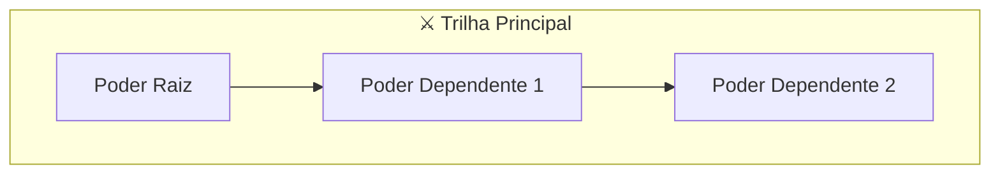

# ⚔️ Nome da Classe
*Classe Base • Tormenta20 JdA*

> [!t20-stats]
> - 🏷️ <span class="t20-roxo">Tipo:</span> Classe de Personagem (Tormenta20 JdA)
> - ❤️ <span class="t20-vermelho">PV:</span> 16 (+4 por nível)
> - 💧 <span class="t20-ciano">PM:</span> 3 (+3 por nível)
> - 🛡️ <span class="t20-laranja">Proficiências:</span> Armas Simples, Armaduras Leves
> - 🎯 <span class="t20-verde">Perícias Básicas:</span> [[Luta]] ou [[Pontaria]], [[Fortitude]]
> - 📚 <span class="t20-amarelo">Perícias Adicionais:</span> +4 à escolha

**Lista de Perícias Adicionais:** [[Acrobacia]], [[Atletismo]], [[Iniciativa]], [[Intimidação]], [[Percepção]], [[Reflexos]].

Breve resumo operacional e papel da classe no sistema.

> [!t20-lore]- Lore e Referência em Arton
> Síntese temática sobre a atuação da classe em Arton.

<!-- OPCIONAL: manter apenas quando subtipo: classe-variante -->
> [!t20-restricao] Regras de Adaptação da Variante
> - **Substituições:** *(atributos ou habilidades alteradas em relação à classe base)*
> - **Restrições:** *(poderes proibidos ou proibições de devoção)*

---

## ⚡ Progressão de Habilidades de Nível

| Nível | Habilidade | Resumo Operacional |
| :---: | :--- | :--- |
| 1º | **Habilidade 1** | Descrição sucinta da habilidade inicial. |
| 2º | **Poder de Classe** | A partir do 2º nível, escolhe um poder da classe por nível. |
| 20º | **Habilidade de Ápice** | Poder supremo de 20º nível. |

---

## 📖 Descrição das Habilidades

### Habilidade 1 *(1º Nível)*
Texto mecânico fiel extraído da fonte oficial, com wikilinks para perícias, condições e regras envolvidas.

### Habilidade de Ápice *(20º Nível)*
Texto mecânico fiel extraído da fonte oficial.

<!-- OPCIONAL: manter apenas para classes conjuradoras -->
> [!t20-magia] Progressão de Magias
> - **Tradição:** Arcana / Divina
> - **Atributo-Chave:** Inteligência / Sabedoria / Carisma
> - **Círculos:** 1º (1º nível) • 2º (5º nível) • 3º (9º nível) • 4º (13º nível) • 5º (17º nível)

---

## 🌳 Árvore de Pré-requisitos de Poderes

<!-- Regra de fidelidade: incluir apenas nós com arquivo .md existente no cofre -->


---

## 📜 Poderes de Classe

### ⚔️ Trilha Principal

```dataview
TABLE
  resumo AS "Efeito Resumido",
  join(default(requer_poder, []), ", ") AS "Pré-requisitos",
  default(requer_nivel, "—") AS "Nível Mín.",
  join(default(magias_relacionadas, []), ", ") AS "Magias Vinculadas"
FROM "Poderes/Classe/<Nome da Classe>"
WHERE tipo = "poder"
  AND trilha_poder = "Trilha Principal"
  AND !contains(default(this.poderes_proibidos, []), file.link)
SORT default(ordem, 999) ASC, default(requer_nivel, 1) ASC, file.name ASC
```

---

### 🌟 Trilha Geral & Poderes Compartilhados

```dataview
TABLE
  resumo AS "Efeito Resumido",
  join(default(requer_poder, []), ", ") AS "Pré-requisitos",
  default(requer_nivel, "—") AS "Nível Mín.",
  join(default(magias_relacionadas, []), ", ") AS "Magias Vinculadas"
FROM "Poderes/Classe/<Nome da Classe>" OR "Poderes/Classe/Comuns"
WHERE tipo = "poder"
  AND (trilha_poder = "Geral" OR !trilha_poder OR file.folder = "Poderes/Classe/Comuns")
  AND (!classes OR contains(classes, this.file.link) OR contains(classes, this.classe_base))
  AND !contains(default(this.poderes_proibidos, []), file.link)
SORT default(ordem, 999) ASC, default(requer_nivel, 1) ASC, file.name ASC
```

---

## 🔀 Classes Variantes

```dataview
TABLE
  fonte AS "Fonte",
  resumo AS "Resumo Operacional"
FROM "Classes"
WHERE tipo = "classe" AND subtipo = "classe-variante" AND classe_base = this.file.link
SORT file.name ASC
```
