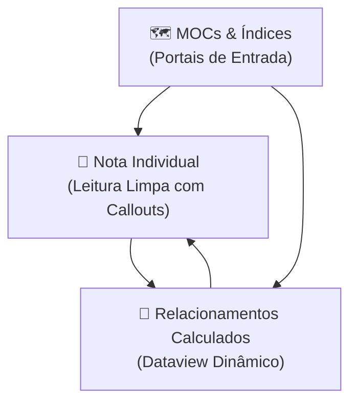

# 🏗️ Arquitetura do Cofre — Wiki Orientada a Índices e Consultas

> Este documento descreve a filosofia de design, invariantes estruturais e procedimentos de manutenção do cofre Tormenta 20.

---

## 1. Filosofia: Wiki Orientada a Índices e Consultas

Este cofre **não é** um repositório de texto corrido repetitivo. Ele opera como uma **wiki orientada a índices e consultas**, onde a informação é armazenada uma única vez e os relacionamentos são calculados dinamicamente.

### Onde a Wiki Ajuda

- Permite saltar de uma **Classe** para seus **Poderes**, de um **Poder** para a **Condição** ou **Perícia** que o aciona, e de um **Deus** para suas **Magias** e **Itens** sem folhear PDFs.
- Consulta cruzada instantânea entre regras do livro básico e múltiplos suplementos.
- Montagem de ficha e consulta em mesa com 2 a 3 cliques.

### Onde a Wiki Pode Travar (e como evitamos)

| Armadilha | Como Evitamos |
|---|---|
| **Manutenção manual de listas** — copiar a mesma magia em vários lugares gera dessincronia | Todas as listas são geradas por **consultas Dataview** que leem o frontmatter YAML |
| **Excesso de metadados visíveis** — dezenas de campos vazios poluem a leitura | **YAML enxuto**: omitimos campos vazios; callouts visuais exibem apenas dados preenchidos |
| **Vínculos sem critério** — linkar todo termo gera ruído no grafo | Links deliberados: somente termos mecânicos e entidades recebem `[[wikilinks]]` |

---

## 2. As 3 Camadas de Navegação



### Camada 1 — Portais de Entrada (MOCs)

Notas-índice que agrupam o sistema por critérios práticos: função tática, tradição, deus, nível ou pré-requisito.

- `00 - Home.md` → Painel principal com links para todos os domínios e campanha
- `Deuses/00 - Panteão de Arton (MOC).md` → Deuses, poderes concedidos, magias de devoção
- `Classes/_Índice Geral de Classes.md` → Tabela de todas as 36 classes
- `Magias/_Índice Geral de Magias.md` → Magias por tradição e círculo
- `Poderes/_Índice Geral de Poderes.md` → Poderes por tipo/categoria
- Cada classe possui seus próprios **diagramas Mermaid** de árvore de pré-requisitos

### Camada 2 — Leitura Limpa

Cada nota individual mostra:

1. **YAML recolhido** — apenas campos preenchidos
2. **Callouts temáticos** (`[!t20-poder]`, `[!t20-restricao]`, `[!t20-magia]`, etc.) para bater o olho nos parâmetros essenciais
3. **Texto descritivo** fiel às fontes oficiais
4. **Wikilinks** para entidades mecânicas relacionadas

### Camada 3 — Relacionamentos Calculados

Nenhuma lista de poderes, magias ou dependentes é mantida manualmente. São todas consultas `dataview`:

- **Poderes por trilha** → `WHERE trilha_poder = "X"`
- **Dependentes de um poder** → `WHERE contains(requer_poder, this.file.link)`
- **Magias de um deus** → Tabela dinâmica na nota do deus comparando `exclusiva_devocao` com `this.file.link`
- **Poderes concedidos por nível** → `SORT requer_nivel ASC`
- **Efeitos sobre perícias** → Tabela reversa em cada perícia usando `requer_pericia`, `pericias_envolvidas` e `pericias_relacionadas`

---

## 3. Invariantes Estruturais

### 3.1 Fidelidade Canônica & Zero Alucinação

- **Fidelidade Mecânica:** Todo texto de regras (poderes, magias, restrições, habilidades, atributos) é transcrito fielmente das fontes oficiais (*JdA*, *HdA*, *DdA*, DB199) para permitir consulta precisa e automação de ficha.
- **Lore Narrativo:** Textos de ambientação, contos e histórico são mantidos como resumos operacionais e de referência rápida.
- Dados incertos são marcados com `[VERIFICAR]` até confirmação com as fontes.
- Diagramas `mermaid` usam **zero nós fantasma** — cada nó corresponde a um arquivo `.md` real existente no cofre.

### 3.2 Hierarquia de Poderes & Ordenação em Dezenas

Para evitar colisões quando uma mesma trilha possui mais de um poder-raiz, a ordenação topológica codificada no campo `ordem` utiliza blocos de dez por árvore temática:

| `ordem` | Significado na Trilha | Exemplo (Clérigo - Liturgia) |
|---|---|---|
| `10` | 1º Poder-Raiz da Trilha | `Abençoar Arma` |
| `11, 12, ...` | Dependentes diretos do 1º Poder-Raiz | `Consagrar Arma`, `Arma Sagrada` |
| `20` | 2º Poder-Raiz da Trilha | `Prece de Combate` |
| `21, 22, ...` | Dependentes diretos do 2º Poder-Raiz | `Bênção de Batalha` |
| `90, 91...` | Poderes independentes da trilha | `Comunhão`, `Símbolo Sagrado` |
| `999` (default) | Poderes sem ordem explicitada | Ficam no final da tabela |

**Consulta padronizada:**
```
SORT default(ordem, 999) ASC, default(requer_nivel, 1) ASC, file.name ASC
```

### 3.3 Poderes Compartilhados (`Poderes/Classe/Comuns/`)

Poderes idênticos presentes em múltiplas classes (ex: `Aumento de Atributo`, `Conhecimento Mágico`) residem exclusivamente em `Poderes/Classe/Comuns/` com o campo `classes: ["[[Classe A]]", "[[Classe B]]"]` no YAML. As consultas de classe leem tanto a pasta da classe quanto `Comuns`, garantindo que não haja 15 arquivos com o mesmo nome quebrando wikilinks curtos.

### 3.4 Classes Variantes

Cada classe variante contém:

1. **Callout `[!t20-restricao]`** no topo — regras de adaptação (atributos substituídos, poderes proibidos)
2. **Diagrama Mermaid** sincronizado com notas reais
3. **Tabelas Dataview** que filtram automaticamente poderes proibidos da classe base

### 3.5 YAML Enxuto e Tipagem Estrita

- Campos vazios (`null`, `[]`, `""`) são **omitidos** do frontmatter.
- Campos relacionais usam wikilinks entre aspas: `"[[Nome da Entidade]]"`.
- Itens de equipamento usam números puros: `preco_ts: <int>` e `espacos: <int>` (regra JdA).

### 3.6 Tabela Mestra de Taxonomia Ontológica

| Entidade / Domínio | `tipo` | `subtipo` ou `categoria` | Pasta Canônica | Campos-Chave no YAML | Modo de Aquisição / Papel no Sistema |
|---|---|---|---|---|---|
| **Classes Básicas** | `classe` | `subtipo: classe-base` | `Classes/` | `pv_inicial`, `pv_por_nivel`, `pm_inicial`, `pericias_basicas`, `proficiencias` | Escolha no 1º nível de personagem. Define progressão base. |
| **Classes Variantes** | `classe` | `subtipo: classe-variante` | `Classes/` | `classe_base`, `poderes_proibidos`, `proibe_devocao` | Substituição da classe base (*Heróis de Arton* / *DB199*). |
| **Habilidades de Classe** | `habilidade` | `subtipo: habilidade-de-classe` | `Habilidades/Classes/` | `classe`, `nivel`, `ativacao`, `custo_pm` | **Automática/Inata** ao atingir o nível da classe (ex.: *Ataque Furtivo*, *Cura Pelas Mãos*). |
| **Poderes de Classe** | `poder` | `categoria: classe` | `Poderes/Classe/<Classe>/` | `classe`, `trilha_poder`, `requer_nivel`, `requer_poder`, `ordem` | **Adquirido**: a cada nível a partir do 2º (trocando poder de classe). |
| **Poderes Compartilhados** | `poder` | `categoria: classe` | `Poderes/Classe/Comuns/` | `classes: ["[[Classe A]]", "[[Classe B]]"]` | **Adquirido**: comum a várias classes (ex.: *Aumento de Atributo*, *Conhecimento Mágico*). |
| **Raças** | `raca` | — | `Raças/` | `tipo_criatura`, `tamanho`, `deslocamento`, `atributos`, `habilidades_base`, `# raca_base` | Escolha na criação. Define biologia, tamanho, modificadores e sentidos. |
| **Habilidades Raciais** | `habilidade` | `subtipo: habilidade-racial` | `Habilidades/Raciais/` | `raca: ["[[Raça]]"]`, `ativacao`, `custo_pm`, `resumo` | **Inata/Gratuita**: concedida automaticamente no 1º nível (ex.: *Sangue Mágico*, *Tradição de Heredrimm*). |
| **Poderes de Raça** | `poder` | `categoria: racial` | `Poderes/Raça/` | `requer_raca: ["[[Raça]]"]`, `ordem`, `requer_poder`, `exclui_raca`, `requer_traco` | **Adquirido**: poder geral opcional de *Heróis de Arton* com pré-requisito racial (ex.: *Citadino*, *Cascos Poderosos*). |
| **Poderes Gerais (Combate)** | `poder` | `categoria: combate` | `Poderes/Combate/` | `requer_atributo`, `requer_pericia`, `requer_poder` | **Adquirido**: poderes marciais gerais (ex.: *Ataque Poderoso*, *Acuidade com Arma*). |
| **Poderes Gerais (Destino)** | `poder` | `categoria: destino` | `Poderes/Destino/` | `requer_atributo`, `requer_pericia`, `requer_nivel` | **Adquirido**: perícias, sorte e utilidade (ex.: *Sortudo*, *Investigador*). |
| **Poderes Gerais (Magia)** | `poder` | `categoria: magia` | `Poderes/Magia/` | `requer_poder`, `magias_relacionadas` | **Adquirido**: metamagia e aprimoramento místico geral (ex.: *Magia Acelerada*). |
| **Poderes da Tormenta** | `poder` | `categoria: tormenta` | `Poderes/Tormenta/` | `penalidade_carisma`, `requer_poder` | **Adquirido**: mutações aberrantes lefeu (ex.: *Anatomia Insana*, *Armamento da Tormenta*). |
| **Poderes Concedidos** | `poder` | `categoria: concedido` | `Poderes/Concedidos/` | `deuses: ["[[Deus]]"]` | **Adquirido**: recebido por devoção a uma divindade do Panteão (ex.: *Afinidade com a Tormenta*). |
| **Poderes de Origem** | `poder` | `categoria: origem` | `Poderes/Origem/` | `origem: "[[Nome da Origem]]"` | **Adquirido**: selecionado na escolha da origem de histórico no 1º nível. |
| **Magias** | `magia` | — | `Magias/<Tradição>/<Círculo>/` | `circulo`, `tradicao`, `escola`, `custo_pm`, `execucao`, `alcance`, `duracao`, `resistencia` | Conjuradas por classes conjuradoras ou concedidas por habilidades. |
| **Divindades** | `divindade` | `categoria: maior` ou `antigo` | `Deuses/` | `titulo`, `energia`, `arma_preferida`, `simbolo_sagrado`, `canalizacao` | Entidades do Panteão. Poderes são mapeados inversamente via `deuses:` no poder. |
| **Itens & Equipamentos** | `item` | `subtipo: arma-*, armadura-*, escudo, esoterico, ferramenta, vestuario, alquimia, etc.` | `Itens/<Categoria>/` | `preco_ts`, `espacos`, `dano`, `critico`, `bonus_defesa`, `penalidade_armadura` | Equipamentos empunhados, vestidos (limite de 4) ou consumíveis. |
| **Condições** | `mecanica` | `subtipo: condicao` | `Mecânicas e Condições/Condições/` | `categoria: "mental \| física \| sentidos"` | Efeitos e penalidades mecânicas de combate (ex.: *Abalado*, *Cego*, *Vulnerável*). |
| **Perícias** | `mecanica` | `subtipo: pericia` | `Mecânicas e Condições/Perícias/` | `atributo_chave`, `somente_treinada` | Testes de perícia, ações e desafios estendidos do sistema. |
| **Regras do Sistema** | `mecanica` | `subtipo: regra` | `Mecânicas e Condições/Regras/` | `resumo`, `sistema` | Regras fundamentais do sistema (combate, descansos, sufocamento, etc.). |
| **Fichas de PJ** | `personagem` | `subtipo: pj` | `Campanha/02_Personagens/` | `classes: ["[[Guerreiro]]"]`, `nivel`, `raca`, `limite_vestidos: 4`, `slot_*` | Ficha jogável com paperdoll anatômico de 3 colunas e slots de itens. Suporta multiclasse em lista. |
| **Sessões de Jogo** | `sessao-rpg` | — | `Campanha/01_Sessões/` | `sessao`, `data`, `resumo` | Diário de bordo e cronologia de jogo da campanha. |
| **NPCs e Ameaças** | `ameaca` | — | `Campanha/03_NPCs e Ameaças/` | `nd`, `tipo_criatura`, `iniciativa`, `defesa` | Statblocks e fichas de oponentes e aliados. |
| **MOCs & Portais** | `moc` | — | Raiz e pastas temáticas | `nome` | Índices dinâmicos gerados por consultas Dataview para navegação rápida. |

---

## 4. Sistema de Callouts (Snippet `tormenta20.css`)

| Callout | Identificador | Comportamento Visual |
|---|---|---|
| **Stats / Badges** | `[!t20-stats]` | Barra horizontal de badges (`.callout-title` oculto por CSS) |
| **Magia** | `[!t20-magia]` | Roxo/Luz com ícone sparkles para parâmetros de conjuração |
| **Pontos de Mana** | `[!t20-pm]` | Azul ciano com ícone flame para custos e aprimoramentos |
| **Poder** | `[!t20-poder]` | Roxo escuro com ícone shield para habilidades e poderes |
| **Restrição** | `[!t20-restricao]` | Vermelho com ícone alert-triangle para adaptações e proibições |
| **Item** | `[!t20-item]` | Dourado/Amarelo com ícone gem para equipamento |
| **Lore** | `[!t20-lore]` | Cinza discreto com ícone scroll-text para ambientação |
| **Ameaça / Statblock** | `[!ameaca]` ou `[!t20-statblock]` | Vermelho escuro com ícone skull para fichas de monstros/NPCs |
| **Combate** | `[!combate]` | Laranja com ícone swords para regras e táticas de encontro |
| **Sessão** | `[!sessao]` | Verde esmeralda com ícone book-open para diários de campanha |
| **Local** | `[!local]` | Azul com ícone map-pin para masmorras e cidades |
| **Tesouro** | `[!tesouro]` | Amarelo com ícone coins para pilhagens e recompensas |

> [!WARNING]
> Toda linha interna de um callout **deve** iniciar com `> `. Nunca utilize `[!t20-stats]` para blocos que precisem exibir título visível.

---

## 5. Consultas Dataview — Padrão Canônico de Referência

### 5.1 Tabela de Poderes por Trilha (Padrão de Classe)

```dataview
TABLE
  resumo AS "Efeito Resumido",
  join(default(requer_poder, []), ", ") AS "Pré-requisitos",
  default(requer_nivel, "—") AS "Nível Mín.",
  join(default(magias_relacionadas, []), ", ") AS "Magias Vinculadas"
FROM "Poderes/Classe/<Classe>" OR "Poderes/Classe/Comuns"
WHERE tipo = "poder"
  AND trilha_poder = "<Trilha>"
  AND (!classes OR contains(classes, this.file.link))
SORT default(ordem, 999) ASC, default(requer_nivel, 1) ASC, file.name ASC
```

### 5.2 Poderes Dependentes de um Poder-Raiz (Dentro da Nota do Poder-Raiz)

```dataview
LIST
FROM "Poderes"
WHERE tipo = "poder" AND contains(requer_poder, this.file.link)
SORT default(requer_nivel, 1) ASC, file.name ASC
```

> [!IMPORTANT]
> Em cláusulas `WHERE contains(...)` sobre campos de wikilink, use **sempre** `this.file.link` (ou `link("Nome")`), **NUNCA** a string literal `"[[Nome]]"`. O Dataview armazena wikilinks como objetos `Link` e a comparação com strings literais retorna falso silenciosamente.

---

## 6. Arquitetura da Informação e Condensação

### 6.1 Profundidade máxima

- Nível 1: `00 - Home.md`.
- Nível 2: MOCs e índices por domínio.
- Nível 3: notas atômicas de regras e entidades.

Nenhuma entidade mecânica deve exigir mais de três saltos.

### 6.2 Divulgação progressiva

- **Scan (1–3 s):** título, subtítulo taxonômico e `[!t20-stats]`.
- **Operacional (5–15 s):** efeito mecânico literal e tabelas primárias.
- **Contexto:** lore e catálogos opcionais em callouts recolhidos.

Manter resumos Dataview em aproximadamente 140 caracteres, tabelas em 4–5 colunas e células vazias como `"—"`.

### 6.3 Higiene de endereçamento

- Nenhuma colisão de nome-base.
- Homônimos recebem sufixo explícito no nome do arquivo.
- Nomes atômicos não começam com emoji.
- Wikilinks ambíguos usam pipe para preservar fluência.

---

## 7. Acessibilidade e Design Dual-Theme

### 7.1 Contraste

- Texto corrido e células: contraste mínimo de 4,5:1.
- Cabeçalhos e bordas: contraste mínimo de 3:1.
- Cores operacionais usam variáveis nativas e variantes claro/escuro.
- Nenhuma informação crítica depende exclusivamente da cor.

### 7.2 Redundância semântica

Badges devem combinar cor e rótulo textual: `PV`, `PM`, `Defesa`, `Preço`, `Espaços` e penalidades.

### 7.3 Ergonomia

- Texto usa unidades relativas (`rem`, `em`) em vez de `px`.
- O paperdoll usa `repeat(auto-fit, minmax(230px, 1fr))`.
- Links e callouts precisam manter área clicável confortável.
- Respeitar `prefers-reduced-motion: reduce`.
- Markdown puro deve continuar legível sem CSS ou Dataview.

### 7.4 Semântica cromática

| Cor | Uso |
|---|---|
| Vermelho | dano, PV, penalidade e restrição |
| Ciano | PM, magia e efeito místico |
| Laranja | defesa, armadura e alerta |
| Verde | ativação, deslocamento e cura |
| Roxo | categoria e classificação |
| Amarelo | preço, tamanho e recurso econômico |

### 5.3 Magias Exclusivas de Devoção (Dentro da Nota do Deus)

```dataview
TABLE circulo AS "Círculo", escola AS "Escola", custo_pm AS "PM"
FROM "Magias"
WHERE tipo = "magia"
  AND (contains(exclusiva_devocao, this.file.link) OR contains(aprimoramento_exclusivo, this.file.link))
SORT circulo ASC, file.name ASC
```

### 5.4 Protegendo Campos Opcionais contra Falhas Nulas

```
join(default(campo, []), ", ")      → para listas
default(campo, "—")                → para escalares
default(campo, 999)                → para ordenação numérica
```

### 5.5 Caminhos FROM e Raiz do Cofre

Use **apenas o caminho relativo** dentro do cofre. A pasta `Tormenta 20\` contém seu próprio diretório `.obsidian/` e opera como cofre raiz:

```
✅ FROM "Poderes/Classe/Clérigo"
❌ FROM "Poderes/Classe/Clérigo"
```

---

## 6. Manutenção e Procedimentos

### 6.1 Criando Novas Notas

1. Use o template correspondente em `Templates/`
2. Preencha **apenas** os campos YAML relevantes (omita os vazios)
3. Adicione wikilinks para entidades mecânicas relacionadas
4. Se for um poder com pré-requisito, defina `requer_poder: ["[[Poder Raiz]]"]` e seu valor em `ordem`

### 6.2 Alterações em Massa (Batch)

1. **Sempre** escreva um script Python em arquivo `.py` na pasta `scratch/` (fora do cofre)
2. **Sempre** use `encoding="utf-8"` ao ler/escrever arquivos
3. **Nunca** execute regex complexo inline no PowerShell
4. Após execução, execute a auditoria de contagem de notas, encoding e colisões

---

## 7. Referência Rápida de Arquivos Especiais

| Arquivo | Propósito |
|---|---|
| `00 - Home.md` | Portal principal raiz de navegação do cofre |
| `Deuses/00 - Panteão de Arton (MOC).md` | Portal de deuses, crenças e poderes concedidos |
| `historico_de_alteracoes.md` | Log histórico de alterações e refatorações |
| `_Meta/README.md` | Visão geral, métricas e vocabulário YAML controlado |
| `_Meta/ARQUITETURA.md` | Filosofia das 3 camadas, invariantes e padrões técnicos (você está aqui) |
| `_Meta/t20-obsidian-rpg-system.md` | Cópia das regras de workspace |
| `.obsidian/snippets/tormenta20.css` | Snippet CSS para estilização de callouts e badges |

---

## 8. Escopo e Propriedade Intelectual

- **Cofre Autônomo:** `g:\Meu Drive\...\Tormenta 20\` é a raiz oficial do cofre.
- **Uso Pessoal e Privado de Mesa:** O cofre é uma ferramenta pessoal para agilizar mestragem, montagem de ficha e consulta em mesa. O texto mecânico é transcrito com fidelidade para permitir cálculo e regras corretas, enquanto textos narrativos e contos literários não são distribuídos ou republicados publicamente.
